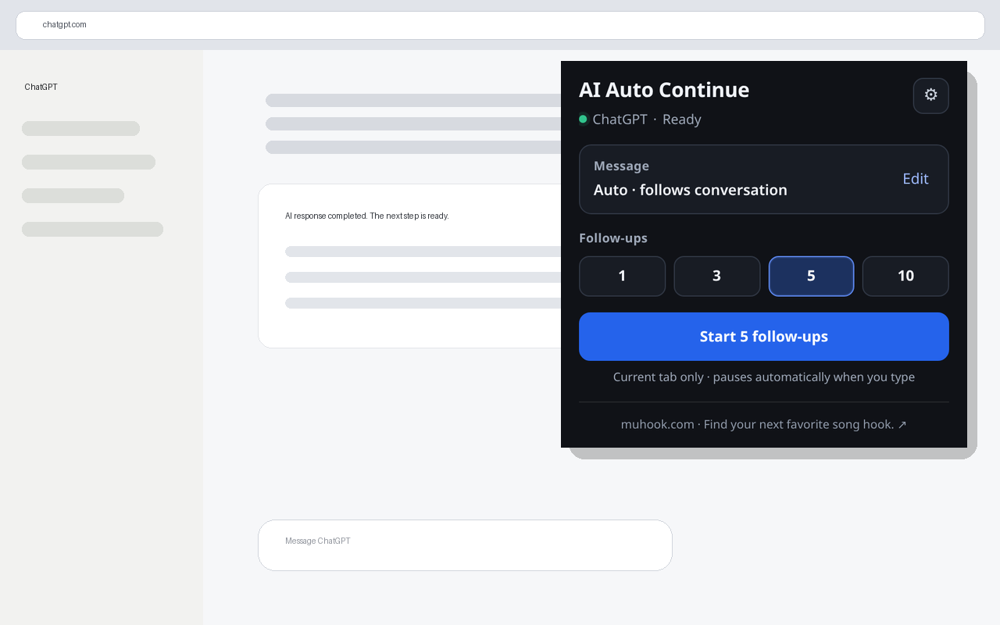

# AI Auto Continue

[English](README.md)

AI Auto Continue 是一个本地优先的浏览器扩展，用于让较长的 AI 对话任务自动继续执行。用户明确点击开始后，插件等待当前 AI 回答结束；如果平台提供可靠的原生“继续生成”按钮，则优先点击，否则再发送受次数限制的续接消息。

当前版本：**1.3.2**



## 核心特点

- **仅内置 Adapter**：生产版本不在未知网站猜测输入框或按钮。
- **用户明确授权**：每次选择 1 / 3 / 5 / 10 次续接后主动开始。
- **原生 Continue 优先**：平台存在可靠“继续生成”时优先使用。
- **自动跟随对话语言**：续接消息可以根据已完成 AI 回答自动选择语言。
- **人工操作保护**：用户输入、手动发送、切换页面等操作可以自动暂停插件。
- **本地优先**：对话内容在浏览器本地处理，不上传到开发者服务器。
- **紧凑 Popup**：高频操作无需滚动，低频参数放在设置页。
- **多浏览器源码**：Chrome、Edge、Firefox、Safari Web Extension 源码，以及功能受限的 Userscript Lite。
- **MIT 开源**。

## 当前适配平台

内置 Adapter：

- ChatGPT
- Claude
- Gemini
- 豆包
- 千问 / Qwen
- DeepSeek
- Kimi
- 腾讯元宝
- 智谱清言 / ChatGLM
- Microsoft Copilot
- Perplexity
- Grok

由于第三方 AI 网页会频繁改版，所有线上 Adapter 在完成当前网页版本的真实登录回归前均按 **Beta** 管理。

## 安全边界

AI Auto Continue 明确不会：

- 在任意未知网站或用户手动绑定的网站运行；
- 绕过登录、验证码、限流、配额或 AI 平台安全措施；
- 在 Chromium 构建中申请 `<all_urls>`；
- 读取 Cookie 或浏览历史；
- 下载远程 JavaScript 或远程 Adapter；
- 把完整 AI 对话上传给开发者。

遇到无法可靠确认的页面状态时，设计原则是暂停，而不是猜测执行。

## 权限

Chromium 构建只使用：

- `activeTab`：只操作用户当前明确启动插件的标签页；
- `scripting`：向当前受支持 AI 标签页注入插件自带运行时代码；
- `storage`：本地保存插件设置。

完整数据处理说明见 [隐私政策](docs/PRIVACY_POLICY.md)。

## 界面语言

Popup 和设置页支持：

- 跟随浏览器
- English
- 简体中文
- 繁體中文
- 日本語
- 한국어

界面语言与自动续接消息语言彼此独立。

## 开发环境

要求：

- Node.js 20+
- Python 3.10+
- Python Playwright
- Chromium（系统安装或 Playwright 管理的浏览器）

发行 ZIP 由 Node.js 内置打包逻辑生成，不依赖系统 `zip` 命令。

安装浏览器测试依赖：

```bash
python3 -m pip install -r requirements-dev.txt
python3 -m playwright install chromium
```

执行完整验证：

```bash
npm run all
```

包括：

```text
Node 测试
→ Chromium DOM 集成测试
→ 多浏览器构建
→ 静态校验
→ 安全/发行审计
→ ZIP 打包
```

## 构建与本地加载

构建：

```bash
npm run build
```

生成：

- `dist/chrome`
- `dist/edge`
- `dist/firefox`
- `dist/safari`
- `dist/userscript`

`dist/` 和 `packages/` 属于生成产物，默认不会提交到 GitHub。

Chrome / Edge 本地加载：

1. 执行 `npm run build`；
2. 打开扩展管理页面；
3. 开启开发者模式；
4. 选择“加载已解压的扩展程序”；
5. 选择 `dist/chrome` 或 `dist/edge`。

## 仓库结构

```text
src/                 插件运行时代码
src/content/         状态机集成与项目维护 Adapter
src/popup/           紧凑 Popup
src/options/         完整设置页
src/_locales/        本地化语言资源
manifest/            基础及浏览器差异 Manifest
build/               构建、校验、安全审计、打包脚本
tests/               Node 与 Chromium 集成测试
userscript/          功能受限的 Userscript Lite
assets/store/        商店及文档图片
docs/                当前架构、安全、测试、隐私与发行文档
privacy-site/        隐私政策静态网页
support-site/        支持信息静态网页
reference/           外部架构研究记录（不包含第三方源码）
.github/              CI、Issue 与 PR 模板
```

## 当前技术文档

- [架构](docs/ARCHITECTURE.md)
- [内置 Adapter 规范](docs/ADAPTERS.md)
- [安全模型](docs/SECURITY_MODEL.md)
- [测试](docs/TESTING.md)
- [发行流程](docs/RELEASE.md)
- [隐私政策](docs/PRIVACY_POLICY.md)

旧版本实施报告和版本专项审查已归档到 `docs/archive/`，仅作为历史参考。

## Userscript Lite

Userscript Lite 与浏览器插件彼此独立，只提供受限的原生续写能力。**不要在同一个 AI 页面同时运行 Userscript Lite 和浏览器插件。** 项目已主动移除页面世界中的运行状态协调信号，避免网页观察或伪造插件运行状态。

## 隐私与支持

- 隐私政策：https://www.oppanda.com/ai-auto-continue/privacy/
- 支持页面：https://www.oppanda.com/ai-auto-continue/support/

Popup 底部还包含一个用户主动点击的发布者链接 `https://muhook.com/`。该链接不是插件功能所必需，插件源码中不包含跟踪或联盟参数。

## 贡献与安全

提交代码前请阅读 [CONTRIBUTING.md](CONTRIBUTING.md)。平台 Adapter 的修改需要保守选择器、自动化测试，以及在宣称 Stable 前完成真实网页验证。

安全漏洞请按照 [SECURITY.md](SECURITY.md) 私下报告，不要先创建公开 Issue。

## 第三方服务与参考

AI Auto Continue 是独立项目，与所适配的 AI 服务提供商不存在官方隶属或背书关系，详见 [TRADEMARKS.md](TRADEMARKS.md)。

项目在架构调研阶段参考过公开项目 `adamlui/chatgpt-auto-continue`，但没有重新分发其源码。详见 [NOTICE.md](NOTICE.md) 与 [reference/README.md](reference/README.md)。

## License

MIT，详见 [LICENSE](LICENSE)。
