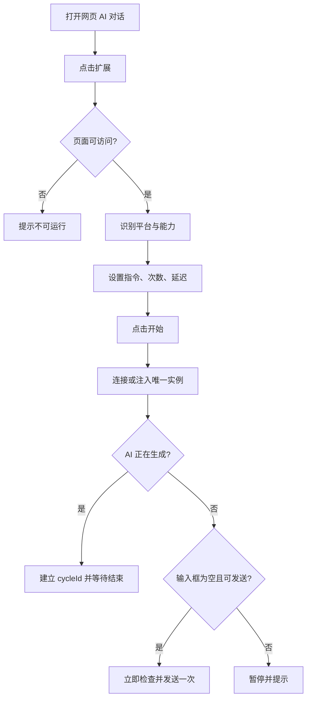
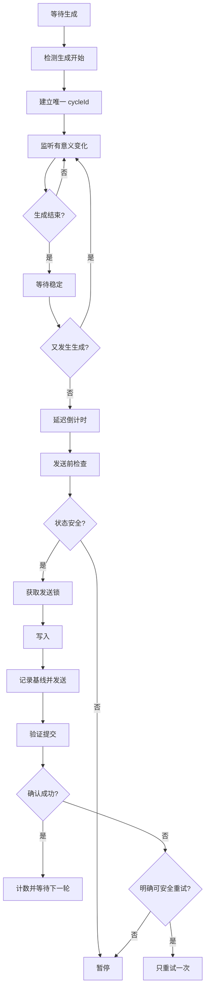
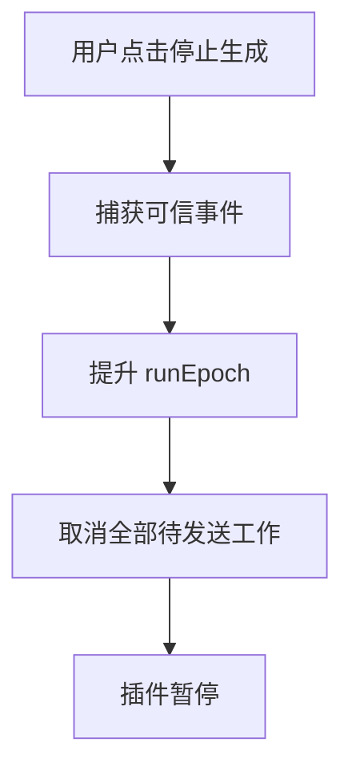

> **Archived architecture note:** User binding and production Generic Adapter sections in this v1.2 design were removed by v1.2.3. Current release behavior is defined by `SPEC_v1.2.3.md` and `REMOVAL_REPORT_v1.2.3.md`.

# AI 网页自动继续插件实施方案 v1.2（Multi-Browser + Dual Continue Strategy）

> 工作名称：AI Auto Continue / AI 自动继续  
> 文档版本：v1.2（Multi-Browser + Dual Continue Strategy）  
> 编制日期：2026-07-27  
> 实施状态：已通过实施安全审查，可进入原型开发；正式发布须通过平台验收矩阵  
> 产品形态：独立多浏览器 WebExtension（Chrome / Edge / Firefox；兼容其他 Chromium；Safari 独立包装）  
> 核心原则：功能单一、本地运行、用户主动启动、原生续写优先、提示词续发兜底、多平台多浏览器

---

## 0. 执行摘要

本插件用于解决网页 AI 在处理长任务时，经常完成一轮输出后停下来，等待用户再次输入“继续”“继续下一步”或其他固定指令的问题。

用户在当前 AI 对话页面启动插件并设置续发内容。插件采用“智能启动”：

- AI 正在生成：等待本轮完整结束后再发送；
- 页面空闲、输入框为空且可发送：完成安全检查后立即发送一次；
- 后续按“生成开始 → 生成结束 → 回答稳定 → 延迟 → 自动发送”循环运行。

运行直到达到次数上限、用户主动停止，或页面进入异常状态。

本产品不判断任务是否真正完成，不调用 AI API，不需要服务器，不上传对话内容，也不要求用户逐轮确认。插件为了判断回答是否仍在变化，会在页面内存中读取必要的 DOM 和文本状态，但默认不持久化、不上传完整问题或回答。

首版采用三层兼容策略：

1. **主流平台精确适配器**：ChatGPT、Claude、Gemini、豆包、千问、DeepSeek、Kimi、腾讯元宝、智谱清言等。
2. **通用网页识别引擎**：识别标准聊天网页的输入框、发送按钮、停止控件和回答区域。
3. **未知网站一次性绑定**：通用识别失败时，用户首次指定必要元素，之后自动使用。

v1.1 增加实施安全必需机制：

- 智能启动，避免页面空闲时永久等待；
- 每轮唯一 `cycleId`；
- 全局发送互斥锁；
- 一轮最多发送一次；
- 用户点击“停止生成”时立即暂停；
- 提交前基线与发送结果验证；
- 发送结果不明确时禁止盲目重试；
- Content Script 重复注入防护；
- 页面刷新、路由切换和 Service Worker 休眠后的状态清理；
- 用户绑定点击拦截，避免真实触发网页按钮；
- `chrome.storage.session` 通过 Service Worker 管理。

综合判断：**v1.1 已达到原型实施标准，但不能跳过真实平台回归测试直接发布。**

## 0.1 v1.0 审查发现与 v1.1 修复

| 等级 | v1.0 问题 | 后果 | v1.1 修复 |
|---|---|---|---|
| 严重 | 页面空闲时启动只能等待“生成开始” | 已结束回答上启动后永久不工作 | 默认智能启动：空闲立即发送，生成中等待结束 |
| 严重 | 用户点“停止生成”后按钮消失可能被判定为自然结束 | 违背用户意图继续发送 | 捕获可信用户操作并立即取消全部待发送任务 |
| 严重 | Observer 多次回调没有轮次锁 | 同一轮可能重复发送 | 增加 `runEpoch + cycleId + sendMutex + sendCommitted` |
| 严重 | 未确认就重试缺少确定性条件 | 已发送但反馈延迟时可能重复发送 | 只有明确未发送才可安全重试；歧义直接暂停 |
| 高 | 误认为 `activeTab` 刷新后自然失效 | 残留状态处理错误 | 显式处理刷新、卸载和 Tab 生命周期 |
| 高 | `storage.session` 访问边界未定义 | Content Script 可能读写失败 | Service Worker 统一管理 session 状态 |
| 高 | 隔离世界直接监听 `pushState` 不可靠 | SPA 切换会话可能漏检 | URL 轮询、根节点观察，必要时最小 MAIN-world 桥 |
| 高 | 用户绑定只记录输入框与发送按钮 | 无法可靠判断回答结束 | 额外绑定停止控件或回答区域 |
| 高 | 绑定点击可能真实触发网页按钮 | 误发送或误操作 | 捕获并阻止 pointer/click，只记录元素 |
| 中 | “不读取回答”表述不准确 | 与稳定检测矛盾 | 改为运行期内存读取，默认不保存、不上传 |
| 中 | ContentEditable 写入策略不充分 | 富文本编辑器可能不同步 | 站点专用写入优先，多级回退并强制验证 |
| 中 | 会话标识可能混用回答指纹 | 流式输出可能被误判为切换 | 会话身份与回答轮次彻底分离 |
| 中 | 平台未声明能力等级 | Agent/研究模式被误认为稳定 | 增加普通聊天/思考/搜索/Agent 能力矩阵 |


## 0.2 v1.2 架构升级

v1.2 借鉴 ChatGPT Auto-Continue 的两个有效方向，但不复制其单平台限制：

### 升级一：双继续策略

```text
Native Continue Button Strategy
        ↓ 未检测到原生继续控件
Prompt Submission Strategy
```

- **Native Continue Button Strategy**：页面出现“继续生成”“Continue generating”“Resume”等平台原生控件时，优先点击该控件；
- **Prompt Submission Strategy**：AI 正常结束、没有原生继续控件时，自动发送“继续”或用户自定义提示词。

该策略解决两种不同中断：

1. 模型单次输出被截断；
2. 模型正常结束一轮，但任务仍需下一步。

### 升级二：多浏览器发行

采用共享核心 + 浏览器适配层：

- Chrome：正式支持；
- Microsoft Edge：正式支持；
- Firefox：正式支持；
- Brave / Opera / Vivaldi 等 Chromium 浏览器：兼容支持；
- Safari macOS：通过 Safari Web Extension 独立包装，完成专项测试后发布；
- 可选 Userscript Lite：只提供原生继续按钮自动点击等轻量能力，不替代完整扩展。

多浏览器不得通过复制多套业务代码实现。状态机、Adapter、继续策略和测试夹具必须共享，只在 Manifest、后台生命周期、API 命名空间、打包和商店发布层保留差异。

# 1. 产品定义

## 1.1 产品名称

暂定工作名称：

- 中文：AI 自动继续
- 英文：AI Auto Continue

后续可独立进行正式命名，不影响技术实施。

## 1.2 一句话定义

> 当网页 AI 输出被截断时自动点击平台原生“继续生成”；当本轮正常结束但任务仍需推进时，自动发送用户预设的“继续”指令。

## 1.3 核心价值

用户在网页 AI 中执行下列任务时，经常需要重复输入“继续”：

- 长篇文档持续优化；
- 多阶段方案编写；
- 代码检查与逐步修复；
- 长内容翻译或改写；
- 多轮分析；
- 分阶段生成清单、文档或素材；
- AI 因单轮输出长度限制而暂停；
- AI 主动提示“可以继续下一步”。

插件把这种重复且机械的操作自动化。

## 1.4 独立插件定位

本功能应作为独立插件，不与截图插件合并。

原因：

1. 用户目标单一，安装后容易理解。
2. 权限范围更小，用户信任成本更低。
3. 不需要图片、截图、OCR、云存储等模块。
4. UI 可以保持极简。
5. 站点适配器可以独立维护。
6. 发布、定价、开源和版本迭代更灵活。
7. 可同时服务国内外 AI 用户，不受截图产品定位限制。

---

# 2. 产品目标与非目标

## 2.1 首版目标

首版必须实现：

1. 用户在当前 AI 对话网页主动启动自动继续。
2. 插件检测 AI 是否正在生成回答。
3. 插件检测平台是否出现原生继续生成控件。
4. 原生继续控件存在时优先点击，不创建新的用户消息。
5. 原生继续控件不存在时，检测本轮回答是否已经结束。
6. 回答结束后等待用户配置的时间。
5. 自动把预设指令写入输入框。
6. 自动发送，不需要用户确认。
7. 按用户设置的次数重复执行。
8. 用户可随时停止。
9. 首版覆盖国内外主流网页 AI。
10. 对未知标准聊天网页提供通用兼容能力。
11. 所有配置和运行数据只保存在浏览器本地。
12. 同一核心代码支持 Chrome、Edge、Firefox，并为 Safari Web Extension 保留独立构建能力。

## 2.2 首版明确不做

首版不包含：

- AI API 调用；
- 服务端；
- 用户账号系统；
- 云同步；
- 多设备同步；
- 对回答内容做复杂语义分析；
- 判断任务是否真实完成；
- 验证文件、代码、测试或工具结果；
- 自动规划不同的下一步提示词；
- 截图；
- OCR；
- 录屏；
- 对话内容上传；
- 自动登录；
- 绕过验证码、限流或平台限制；
- 自动跨多个标签页执行任务；
- 移动浏览器支持。

## 2.3 产品承诺边界

可以承诺：

> 自动检测网页 AI 本轮输出结束，并自动发送用户预设内容。

不能承诺：

> 自动保证任何任务最终完成。

插件只负责“继续发送”，不负责判断结果质量。

---

# 3. 典型使用场景

## 3.1 简单继续

用户设置：

```text
继续
```

自动发送 5 次。

适合 AI 因单轮长度或流程拆分而停止的任务。

## 3.2 继续下一步

用户设置：

```text
继续下一步
```

适合明确按步骤推进的方案、代码或文档任务。

## 3.3 检查后继续

用户设置：

```text
检查刚才完成的内容，如果有问题就修复，然后继续下一步。
```

适合程序实施、文档审查和持续优化。

## 3.4 持续实施

用户设置：

```text
按照已有方案继续实施剩余内容，不要重复已完成部分。
```

适合长工程或长文档。

## 3.5 自定义固定指令

用户可以保存多个预设：

| 预设名称 | 指令 |
|---|---|
| 简单继续 | 继续 |
| 下一步 | 继续下一步 |
| 检查并继续 | 检查刚完成的内容，有问题就修复，然后继续下一步 |
| 不要询问 | 根据已有信息直接继续，不要停下来询问我 |
| 自定义 | 用户输入的任意文本 |

---

# 4. 首版功能范围

## 4.1 必须功能

### A. 自动继续开关

- 当前标签页独立启用；
- Popup 关闭后继续运行；
- 停止后取消全部计时器、Observer 和待处理 Promise；
- 同一页面只能存在一个运行实例；
- 再次点击开始时更新现有实例，不重复注入。

### B. 预设发送内容

- 默认：`继续`
- 支持编辑和保存多个预设；
- 运行期可读取必要页面状态；
- 默认不持久化、不上传完整回答。

### C. 智能启动行为

| 启动时页面状态 | 默认行为 |
|---|---|
| AI 正在生成 | 等待本轮完整结束后发送 |
| 页面空闲、输入框为空、发送按钮可用 | 安全检查后立即发送一次 |
| 输入框已有内容 | 暂停，不覆盖 |
| 状态不明确 | 暂停并提示 |
| 登录、验证码、限流或服务异常 | 暂停 |

高级设置可提供“只等待当前回答结束”，但默认使用智能启动。

插件成功发送的每一条消息都计数，包括首次立即发送。

### D. 最大发送次数

推荐：1、3、5、10、20、自定义；默认 5 次。

高级设置可提供持续运行，但仍受最长运行时间、每分钟频率和随时停止约束。

### E. 回答结束后的等待时间

推荐：2、3、5、10 秒、自定义；默认 3 秒。

倒计时期间若再次出现生成活动，取消倒计时并返回生成状态。

### F. 回答稳定时间

- 普通聊天默认 2.5 秒；
- 搜索/深度思考由 Adapter 推荐 5～10 秒；
- 只计算有意义的回答变化；
- 忽略光标、计时标签、动画属性和插件 UI；
- 结束前再次检查强生成信号。

### G. 网页内运行状态

```text
AI 自动继续
等待 AI 完成本轮回答
已发送 2 / 5
[停止]
```

要求：

- Closed Shadow DOM；
- 不遮挡输入框；
- 可拖动、折叠；
- 点击停止立即使当前 `runEpoch` 失效；
- 旧异步流程失效后不得修改页面。

### H. 用户输入保护

若输入框存在非插件文字：

- 不覆盖；
- 不发送；
- 自动暂停。

覆盖键盘、粘贴、拖放、语音、自动填充和 IME。插件写入使用内部 `writeToken`，不能只依赖 `event.isTrusted`。

### I. 用户手动停止生成保护

用户点击“停止生成/Stop/Cancel”时：

1. 捕获可信用户事件；
2. 立即进入 `PAUSED_BY_USER_STOP`；
3. 提升 `runEpoch`；
4. 取消稳定等待和延迟倒计时；
5. 停止按钮消失不得触发续发。

用户必须重新点击开始才能恢复。

### J. 对话切换保护

以下情况自动停止：

- 会话 ID 变化；
- 切换或新建对话；
- 消息根节点被替换且无法确认同一会话；
- 页面跳转、刷新、关闭；
- 退出登录。

会话标识不能使用正在变化的最新回答文本；回答轮次标识与会话标识必须分离。

### K. 每轮幂等与重复发送防护

```ts
interface ResponseCycle {
  runEpoch: number;
  cycleId: string;
  assistantAnchor: string | null;
  generationStartedAt: number;
  sendCommitted: boolean;
}
```

硬性不变量：

1. 一个 `cycleId` 最多提交一次；
2. 同时最多一个 `sendMutex`；
3. Observer 重复回调不能重复创建发送任务；
4. 停止、切换会话或重新开始后旧 `runEpoch` 全部失效；
5. 发送前后都校验 `runEpoch` 与 `cycleId`。

### L. 发送确认

发送前记录：

```ts
interface SubmitBaseline {
  cycleId: string;
  submittedAt: number;
  promptHash: string;
  userMessageCount: number;
  latestUserMessageAnchor: string | null;
  composerSnapshot: string;
}
```

强成功信号：

- 基线之后出现文本匹配的新用户消息；
- 基线之后开始新的 AI 生成；
- Adapter 返回可验证的提交状态。

中等信号：

- 输入框清空；
- 发送按钮切换；
- 消息列表变化但角色不明确。

成功要求：至少一个强信号，或两个独立中等信号且无失败信号。

结果不明确时：不计数、不重试、暂停提示。

只有同时满足“无新用户消息、无新生成、输入框仍保留插件文本、Adapter 明确未触发提交、当前轮尚未提交”才允许一次安全重试。


### N. Native Continue Button Strategy

平台原生继续控件优先于发送新提示词。

典型控件：

- Continue generating
- Continue
- Resume
- 继续生成
- 继续回答
- 继续输出

但不能仅按按钮文本全页面模糊匹配。必须同时验证：

1. 控件位于当前 Assistant 回答或生成状态区域；
2. Adapter 将其声明为 `nativeContinueControl`；
3. 当前页面类型允许原生续写；
4. 控件不是普通聊天中的建议问题、菜单项或编辑器按钮；
5. 当前运行代次和会话仍有效；
6. 用户未手动停止生成；
7. 当前轮未执行过原生继续。

原生继续执行后：

- 不增加“自动发送提示词”的计数；
- 单独增加 `nativeContinueCount`；
- 等待同一回答继续生成；
- 不创建新 `cycleId`，而是延长当前回答轮次；
- 必须验证回答重新开始变化，或平台重新进入 generating；
- 无法确认时暂停，不立即改用提示词策略，防止双重继续。

建议设置独立上限：

- 单轮原生继续最多 10 次；
- 默认最多 5 次；
- 达到上限后暂停并提示，不自动发送提示词绕过。

### O. 双策略决策顺序

```text
检测到当前轮生成结束或输出截断
        ↓
Adapter 是否检测到可靠的原生继续控件？
        ├── 是 → Native Continue Button Strategy
        │          ↓
        │      验证重新生成
        │          ↓
        │      继续观察同一回答轮次
        │
        └── 否 → 回答是否自然结束并稳定？
                   ├── 是 → Prompt Submission Strategy
                   └── 否 → 继续等待或暂停
```

核心规则：

- 原生继续与提示词续发不能在同一时刻并发；
- 原生继续执行结果不明确时禁止立即发送预设提示词；
- 用户可在高级设置关闭原生继续策略；
- 每个平台 Adapter 必须分别声明两种策略是否支持；
- Generic Adapter 只有高置信度时才允许点击原生继续控件。

# 5. 首版平台覆盖策略

## 5.1 目标

使用统一运行引擎，站点差异通过轻量 Adapter 解决。

建议宣传：

> 支持 ChatGPT、Claude、Gemini、豆包、千问、DeepSeek、Kimi 等主流网页 AI，并兼容多数标准网页对话工具。

不宣传“支持所有 AI 网站或所有模式”。

## 5.2 支持等级

- **Level A：内置精确适配**：普通聊天经过专门测试。
- **Level B：通用兼容**：通用引擎识别完整闭环。
- **Level C：用户绑定**：首次绑定必要元素。
- **Level D：不支持**：跨域 iframe、Closed Shadow DOM、Canvas 自绘或无法可靠验证提交。

## 5.3 平台能力矩阵

```ts
interface AdapterCapabilities {
  nativeContinueButton: "stable" | "beta" | "unsupported";
  promptSubmission: "stable" | "beta" | "unsupported";
  standardChat: "stable" | "beta" | "unsupported";
  reasoningMode: "stable" | "beta" | "unsupported";
  webSearchMode: "stable" | "beta" | "unsupported";
  deepResearchMode: "stable" | "beta" | "unsupported";
  agentMode: "stable" | "beta" | "unsupported";
  userBindingFallback: boolean;
}
```

首版发布承诺以普通聊天为主。复杂模式只有通过专项测试后才能标记稳定。

## 5.4 首版内置平台

| 平台 | 主要域名配置 | 首版承诺 |
|---|---|---|
| ChatGPT | `chatgpt.com` | 普通聊天稳定；其他模式按矩阵 |
| Claude | `claude.ai`、`claude.com` | 普通聊天稳定 |
| Gemini | `gemini.google.com` | 普通聊天稳定；搜索/思考按实测 |
| 豆包 | `doubao.com` | 普通聊天稳定 |
| 千问 / Qwen | `qianwen.com`、`chat.qwen.ai` | 普通聊天稳定 |
| DeepSeek | `chat.deepseek.com` | 普通聊天稳定；深度思考专项测试 |
| Kimi | `kimi.com` | 普通聊天稳定；Agent/研究单独标记 |
| 腾讯元宝 | `yuanbao.tencent.com` | 普通聊天稳定 |
| 智谱清言 | `chatglm.cn` | 普通聊天稳定 |
| Microsoft Copilot | `copilot.microsoft.com`、`copilot.com` | 按实测标记 |
| Perplexity | `perplexity.ai` | 搜索型对话专项测试 |
| Grok | `grok.com` | 普通聊天稳定；搜索按实测 |

域名是运行配置，每次发布前重新检查入口、重定向和登录流程。

P1 通用验证或后续精确适配：Poe、Mistral Le Chat、Meta AI、文小言/文心、纳米 AI、秘塔、讯飞星火、天工、You.com、HuggingChat。

## 5.5 发布分层

- **Stable**：完成普通聊天全量回归，严重误操作为 0。
- **Beta**：可运行，但复杂模式未完成完整回归。
- **Unsupported**：无法建立可靠闭环。

## 5.6 发布标准

- 12 个目标平台均有内置 Adapter；
- 至少 8 个达到普通聊天 Stable；
- 其余至少为 Beta；
- 通用兼容在不少于 5 个未内置平台验证；
- 用户绑定在不少于 5 个测试网站验证；
- 所有平台通过“用户停止后不续发”和“同一轮不重复发送”测试。

# 6. 用户操作流程

## 6.1 首次使用与智能启动



## 6.2 正常运行



## 6.3 用户手动停止 AI



## 6.4 统一停止

停止来源：Popup、悬浮条、快捷键、用户停止生成、切换会话、手动输入、刷新、异常、次数或时间上限。

统一停止必须：

1. 提升 `runEpoch`；
2. 断开 Observer 和监听器；
3. 清除计时器；
4. 释放发送锁；
5. 更新 UI；
6. 通知 Service Worker 清理 Tab 状态。

# 7. 技术架构

## 7.1 总体架构

```text
Chrome / Edge Extension
│
├── Popup UI
├── Service Worker
│   ├── 注入与实例握手
│   ├── Tab 运行索引
│   ├── storage.session 统一访问
│   ├── Badge 管理
│   └── 刷新/关闭清理
├── Browser Compatibility Layer
│   ├── WebExtension API Wrapper
│   ├── Manifest Builder
│   ├── Background Runtime Adapter
│   └── Store Packaging Profiles
│
├── Content Script Runtime
│   ├── LifecycleCoordinator
│   ├── AutoContinueController
│   ├── ResponseCycleManager
│   ├── ContinueStrategyCoordinator
│   ├── NativeContinueButtonStrategy
│   ├── PromptSubmissionStrategy
│   ├── SendMutex
│   ├── GenerationDetector
│   ├── ComposerController
│   ├── SubmissionVerifier
│   ├── ConversationGuard
│   └── RuntimeOverlay
├── Optional MAIN-world One-Shot Route Bridge
├── Adapter Layer
└── Local Storage
```

## 7.2 职责边界

**Content Script 是运行时主控**：状态机、DOM Observer、倒计时和发送锁都在页面内运行。

**Service Worker 是协调器**：注入、防重复、最小运行索引、Badge、刷新/关闭清理和快捷键。不能依赖其全局变量长期存活。

`chrome.storage.session` 默认不向 Content Script 暴露，首版通过消息由 Service Worker 统一访问。

## 7.3 唯一实例与注入握手

1. Popup 先发送 `PING_RUNTIME`；
2. 已存在则返回版本与状态；
3. 不存在才 `executeScript()`；
4. 二次启动只更新配置或重启现有实例；
5. 不建立第二套 Observer。

```ts
type RuntimeCommand =
  | { type: "PING_RUNTIME" }
  | { type: "START_RUN"; config: RunConfig }
  | { type: "STOP_RUN"; reason: StopReason }
  | { type: "GET_STATUS" };
```

## 7.4 推荐技术栈

Manifest V3、TypeScript、轻量原生 UI、无后端、无远程代码。首版正式支持 Chrome 和 Edge；其他 Chromium 浏览器只做兼容验证。

## 7.5 `activeTab` 权限模型

```json
{
  "permissions": ["activeTab", "scripting", "storage"]
}
```

注意：

- 用户主动调用后获得当前 Tab 临时访问；
- 同源路径变化或刷新后权限可能继续有效；
- 不能依赖权限撤销停止任务；
- 刷新会销毁 Content Script，Service Worker 必须显式清理旧索引和 Badge；
- 不同源导航或关闭 Tab 后权限撤销。

## 7.6 执行世界

默认 `ISOLATED` world。

只有确需路由观察时才允许扩展包内的静态 MAIN-world 一次性函数，且：

- 不传递对话文本和预设；
- 只发“路由变化”信号；
- 该信号只能触发重新校验或停止；
- 禁止长期双向桥。


## 7.7 多浏览器共享架构

### 7.7.1 支持矩阵

| 浏览器 | 首版状态 | 构建方式 | 发布渠道 |
|---|---|---|---|
| Google Chrome | Stable | Chromium MV3 | Chrome Web Store |
| Microsoft Edge | Stable | 复用 Chromium MV3 构建 | Microsoft Edge Add-ons |
| Firefox | Stable | Firefox MV3 Manifest 变体 | Firefox Add-ons |
| Brave | Compatible | Chromium 构建 | Chrome Web Store / 手动安装 |
| Opera | Compatible | Chromium 构建或商店专包 | Opera Add-ons / Chrome Web Store兼容 |
| Vivaldi | Compatible | Chromium 构建 | Chrome Web Store / 手动安装 |
| Safari macOS | Planned Stable | Safari Web Extension + Xcode 容器 | Mac App Store / 开发者签名 |
| Safari iOS/iPadOS | 后续评估 | Safari Web Extension | App Store |
| Userscript | Lite | 单文件脚本 | Userscript Manager |

“Compatible”表示共享代码理论兼容并完成基础验证，不等于所有版本都承担正式支持 SLA。

### 7.7.2 统一 API 命名空间

业务代码禁止直接散落调用 `chrome.*` 或 `browser.*`。

统一封装：

```ts
interface ExtensionRuntimeApi {
  sendMessage<T>(message: unknown): Promise<T>;
  getCurrentTab(): Promise<BrowserTab | null>;
  executeContentScript(request: ScriptRequest): Promise<void>;
  storageLocal: ExtensionStorageArea;
  storageSession: ExtensionStorageArea;
  setBadge(tabId: number, text: string): Promise<void>;
}
```

实现：

```text
ChromiumRuntimeApi
FirefoxRuntimeApi
SafariRuntimeApi
```

优先使用 Promise 形式；对仍使用 callback 的浏览器 API 在兼容层中转换。

### 7.7.3 Manifest 构建

不维护三份手写 Manifest。使用公共模板和浏览器覆盖：

```text
manifest/
├── base.json
├── chromium.override.json
├── firefox.override.json
└── safari.override.json
```

构建输出：

```text
dist/
├── chrome/
├── edge/
├── firefox/
├── safari/
└── userscript/
```

Firefox 特有配置例如：

```json
{
  "browser_specific_settings": {
    "gecko": {
      "id": "ai-auto-continue@example.com",
      "strict_min_version": "128.0"
    }
  }
}
```

具体最低版本在发布前依据实际使用 API 确定，不在方案阶段写死为永久值。

### 7.7.4 后台生命周期差异

- Chromium MV3：Service Worker；
- Firefox MV3：根据当前实现与 Manifest 能力使用兼容后台配置；
- Safari：Safari Web Extension 后台环境与包含 App 生命周期单独适配；
- 业务运行主控仍在 Content Script，不依赖后台常驻。

因此继续保留原则：

> 后台层只负责协调、注入、Badge 和最小状态；自动继续状态机在页面 Content Script 中运行。

### 7.7.5 Safari 策略

Safari 不直接复制 Chromium 发布包。

流程：

1. 先完成 Chromium / Firefox 公共核心；
2. 使用 Safari Web Extension 工具或 Xcode 项目包装；
3. 检查 Safari 支持的 API；
4. 替换不兼容 Manifest 键；
5. 完成 macOS Safari 专项测试；
6. 使用 Apple 签名和发布流程。

Safari 首版不应阻塞 Chrome、Edge、Firefox 发布。Safari 包作为同一产品的独立发行目标，但必须通过专项验收后上线。

### 7.7.6 Userscript Lite

可借鉴参考项目提供 Userscript 版本，但必须明确它是精简版：

支持：

- 原生继续按钮自动点击；
- 少量站点的固定 Adapter；
- 本地开关。

不支持或不保证：

- 完整 Popup；
- 多轮提示词发送状态机；
- session 生命周期协调；
- 安全用户绑定；
- 完整 Badge 和商店级权限体验。

Userscript Lite 用于 Safari 或受限环境快速覆盖，不得与完整扩展混用同一页面，必须检测互斥。

# 8. 运行状态机

## 8.1 状态

```ts
type RunState =
  | "IDLE" | "ARMED" | "READY_IDLE"
  | "WAITING_GENERATION_START" | "GENERATING"
  | "WAITING_STABLE" | "DELAYING"
  | "PRE_SEND_CHECK" | "WRITING"
  | "SUBMITTING" | "CONFIRMING"
  | "PAUSED" | "FINISHED" | "ERROR";
```

## 8.2 运行代次

每次开始、重新开始或停止：

```ts
runEpoch += 1;
```

所有异步流程捕获 `expectedEpoch`，每个 `await` 后检查。旧代次直接返回。

## 8.3 回答轮次

确认生成开始后创建：

```ts
interface ResponseCycle {
  runEpoch: number;
  cycleId: string;
  responseAnchor: string | null;
  startedAt: number;
  lastMeaningfulActivityAt: number;
  sendCommitted: boolean;
}
```

同一轮 Observer 重复回调共享同一个 `cycleId`。

## 8.4 发送互斥

- 只有 `PRE_SEND_CHECK` 可获取锁；
- 锁存在时其他回调返回；
- 提交前标记 `sendCommitted`；
- 停止、暂停和异常必须释放锁；
- 已提交轮次不能再次获取锁。

## 8.5 智能启动

```text
生成中 → 建立 cycleId → GENERATING
空闲且安全 → READY_IDLE → 立即发送
状态不明 → PAUSED
```

首次立即发送使用专用 `initialCycleId`，仍受一轮一次规则约束。

## 8.6 提交确认与下一轮生成并发

网页通常在发送成功后立即开始 AI 生成，而插件可能仍处于 `CONFIRMING`。此时不能直接用新回答覆盖正在确认的发送轮次。

需要维护：

```ts
interface PendingGenerationStart {
  detectedAt: number;
  responseAnchor: ResponseAnchor | null;
}
```

规则：

1. `SUBMITTING/CONFIRMING` 期间检测到生成开始，只记录到 `pendingGenerationStart`；
2. 该信号同时作为提交成功的强证据；
3. 提交确认完成后，再把它转换为新的 `ResponseCycle`；
4. 如果提交失败或歧义，丢弃该缓存并暂停；
5. 不允许新生成事件覆盖正在提交的 `cycleId`。
6. 稳定等待或延迟期间恢复生成时，必须保留原 `cycleId`；
7. 发送前检查或写入期间恢复生成时，必须暂停并取消提交。

## 8.7 核心不变量

1. `sentCount <= maxCount`
2. 一个 `cycleId` 最多一次已确认发送；
3. 同时最多一个发送锁；
4. `PAUSED/FINISHED/ERROR` 不得进入写入和提交；
5. 用户停止后旧代次不得修改页面；
6. 会话变化后不得发送；
7. 输入框不为空不得写入；
8. 结果歧义不得自动重试。


## 8.8 原生继续轮次状态

```ts
interface NativeContinueAttempt {
  runEpoch: number;
  cycleId: string;
  attemptId: string;
  controlFingerprint: string;
  attemptedAt: number;
  confirmed: boolean;
}
```

不变量：

1. 同一 `cycleId + controlFingerprint` 最多点击一次；
2. 原生继续执行期间持有统一 `continueStrategyLock`；
3. `NativeContinueButtonStrategy` 和 `PromptSubmissionStrategy` 共享同一把策略锁；
4. 原生继续确认成功后保留当前 `cycleId`；
5. 原生继续确认失败或歧义时暂停；
6. 不允许自动从原生继续失败降级到提示词发送；
7. 用户停止生成会取消原生继续的等待确认。

# 9. AI 生成状态检测

## 9.1 检测原则

不能只依赖单一选择器。组合使用停止控件、输入/发送状态、当前回答有意义变化、思考/搜索/工具状态和 Adapter 特定信号。

必须区分：

- AI 正在生成；
- 页面无关动画；
- 回答短暂停顿；
- 用户主动停止；
- 自然结束。

## 9.2 信号分级

### 强信号

- 明确停止生成控件；
- 发送按钮切换为停止按钮；
- Adapter 明确识别 generating/reasoning/researching；
- 当前回答持续增加有意义文本或内容块；
- 工具明确仍在执行。

### 中等信号

- 发送按钮或输入框 disabled；
- 当前回答区域发生有意义 mutation；
- “思考中/搜索中/生成中”等明确状态文本。

### 弱信号

- 通用 spinner；
- 任意网络活动；
- 光标闪烁；
- 时间标签；
- class/style/动画属性变化。

弱信号不能单独确认生成或延长稳定时间。

## 9.3 有意义变化过滤

忽略：

- 插件 UI；
- 无关 `aria-live` 计时；
- 流式光标；
- 复制/点赞按钮；
- 隐藏节点；
- 仅样式和动画变化；
- 侧边栏、历史、推荐和通知区域。

有意义变化：

- 当前回答文本或内容块变化；
- 引用、代码、图片、工具结果增加；
- 当前回答根节点替换；
- Adapter 指定状态变化。

## 9.4 回答锚点

```ts
interface ResponseAnchor {
  messageRootId: string | null;
  messageNode: Element | null;
  messageIndexBaseline: number;
  contentHashBaseline: string | null;
}
```

之后只观察当前轮回答或其合法替代节点，不能因旧消息和侧边栏变化延迟发送。

## 9.5 回答结束判定

进入稳定等待必须满足：

1. 已确认当前轮生成开始；
2. 没有强生成信号；
3. 用户未主动停止；
4. 会话未变化；
5. 回答锚点可解析，或 Adapter 明确报告完成；
6. 无登录、验证码、限流和错误遮罩。

稳定条件：

```text
now - lastMeaningfulActivityAt >= stabilityMs
```

稳定后、发送前再次检查生成信号、锚点、会话、`runEpoch`、用户输入和用户停止状态。

## 9.6 通用生成评分

```ts
function scoreGenerating(s: GenerationSignals): number {
  let score = 0;
  if (s.stopControlVisible) score += 60;
  if (s.currentResponseMutating) score += 35;
  if (s.generatingLabelVisible) score += 30;
  if (s.sendControlDisabled) score += 15;
  if (s.composerDisabled) score += 10;
  if (s.genericSpinnerVisible) score += 5;
  return score;
}
```

- `>= 60`：确认生成中；
- `40～59`：疑似，继续观察；
- `< 40`：不能确认。

评分只辅助判断，不直接触发发送。

## 9.7 Observer 生命周期

观察消息根、当前回答、输入区、发送/停止控件和阻塞区域。停止时全部 `disconnect()`。

低频兜底：

- 750～1500 毫秒；
- 只检查关键节点替换；
- 页面隐藏时降低频率；
- 恢复后重建锚点；
- 不高频扫描全 DOM。


## 9.8 原生继续控件检测

Adapter 返回结构化结果：

```ts
interface NativeContinueControlResult {
  status: "available" | "unavailable" | "ambiguous";
  element: HTMLElement | null;
  confidence: number;
  fingerprint: string | null;
  reason?: string;
}
```

精确 Adapter 的判断依据：

- 平台已知选择器；
- 当前回答容器内的结构关系；
- 可访问名称；
- 控件出现时的生成状态；
- 当前页面模式；
- 按钮是否可见、可用；
- 是否属于当前最新回答。

Generic Adapter 的置信度门槛高于普通发送按钮识别。至少满足：

- 明确文本或 aria-label；
- 位于最新 Assistant 输出附近；
- 不在导航、菜单或建议提示区域；
- 页面刚刚出现输出截断或生成结束；
- 控件点击后可验证重新生成。

禁止只使用：

```ts
document.querySelectorAll("button")
  .find(button => button.textContent.includes("Continue"))
```

因为这会误点普通“继续”按钮、设置向导、建议问题或其他页面操作。

# 10. 输入框识别与文本写入

## 10.1 支持类型

支持 Textarea、Input、ContentEditable、`role=textbox`、ProseMirror、Lexical、Slate、TipTap、受控组件和 Open Shadow DOM。

不保证 Closed Shadow DOM、Canvas 编辑器、跨域 iframe 和桌面原生嵌入组件。

## 10.2 输入框候选评分

```text
页面下半部/底部：+20
role=textbox：+20
contenteditable=true：+20
textarea：+20
placeholder 含发送/提问/Message/Ask：+20
可见且尺寸合理：+15
附近存在发送按钮：+20
位于主聊天容器：+20
弹窗/搜索/评论/侧边栏：-40
只读或 disabled：-100
```

第一候选需超过阈值，并与第二候选有足够分差，否则进入绑定。

## 10.3 用户内容检测

统一读取“可见规范文本”。以下不视为空：

- 非空白文字；
- 附件或草稿占位；
- IME composition；
- 页面保存草稿；
- 自动填充文本。

非空则暂停，不覆盖。

## 10.4 写入策略级联

### Level 1：Adapter 专用写入

用于 Lexical、ProseMirror 等经过测试的编辑器。

### Level 2：原生控件 setter

Textarea/Input：

1. 聚焦；
2. 调用原型原生 `value` setter；
3. 派发 `beforeinput`、`input`，必要时 `change`；
4. 等待一帧和微任务；
5. 重新读取验证。

### Level 3：ContentEditable 兼容写入

1. 聚焦并设置 Selection；
2. Adapter 允许时使用兼容 `insertText` 回退；
3. 派发输入事件；
4. 读取可见文本验证。

`execCommand('insertText')` 只能作为兼容回退，不能作为唯一方案。

### Level 4：静态 MAIN-world 一次性调用

仅站点 Adapter 确需时：

- 扩展包内静态函数；
- 仅传待写入文本和一次性令牌；
- 调用后销毁；
- 不建立长期桥；
- 隔离世界继续验证。

## 10.5 写入令牌

```ts
interface WriteToken {
  runEpoch: number;
  cycleId: string;
  expectedTextHash: string;
  expiresAt: number;
}
```

令牌有效且内容与预期一致时，不把插件事件误判为用户输入；过期或偏离立即暂停。

## 10.6 写入成功标准

全部满足：

1. `runEpoch/cycleId` 有效；
2. 可见文本与预设规范化后一致；
3. 无额外用户内容；
4. 发送按钮可用；
5. 会话未切换。

失败时不得点击发送。

## 10.7 禁止行为

- 不覆盖用户内容；
- 不操作 React 私有字段；
- 不默认使用剪贴板；
- 不逐字符模拟键盘；
- 不执行网页或服务器代码；
- 不用 `innerHTML` 插入用户文本；
- IME 组合期间不发送。


# 10A. 继续策略协调器

## 10A.1 接口

```ts
interface ContinueStrategy {
  id: "native_button" | "prompt_submission";

  canExecute(
    context: ContinueContext
  ): Promise<StrategyAvailability>;

  execute(
    context: ContinueContext
  ): Promise<ContinueExecutionResult>;
}
```

## 10A.2 策略协调

```ts
class ContinueStrategyCoordinator {
  async continue(context: ContinueContext) {
    const lock = this.strategyLock.tryAcquire(context.cycleId);
    if (!lock) return;

    try {
      const nativeAvailability =
        await this.nativeStrategy.canExecute(context);

      if (nativeAvailability.status === "available") {
        return await this.nativeStrategy.execute(context);
      }

      if (nativeAvailability.status === "ambiguous") {
        return {
          status: "paused",
          reason: "native_continue_ambiguous"
        };
      }

      return await this.promptStrategy.execute(context);
    } finally {
      this.strategyLock.release(context.cycleId);
    }
  }
}
```

## 10A.3 原生继续执行验证

点击前记录：

- 当前回答长度 / 内容块数量；
- 当前生成状态；
- 原生控件指纹；
- 当前 `cycleId`；
- 当前用户消息数量。

成功信号：

- 同一回答节点重新开始增加内容；
- 页面重新进入 generating；
- 原生继续控件消失且回答发生有意义变化。

失败或歧义：

- 点击后没有任何状态变化；
- 控件消失但回答没有继续；
- 新增了一条用户消息；
- 页面跳转；
- 出现错误、登录或限流。

结果歧义时暂停，不执行提示词策略。

## 10A.4 计数分离

```ts
interface ContinueCounters {
  promptSubmissionCount: number;
  nativeContinueCount: number;
}
```

UI 默认显示：

```text
自动发送：2 / 5
原生续写：1 / 5
```

防止用户误解原生续写点击占用了提示词发送次数。

# 11. 自动发送机制

## 11.1 发送按钮识别

候选：`button[type=submit]`、可访问名称包含 send/submit/发送/提交、输入框邻近主按钮和 Adapter 选择器。

排除：停止、上传、语音、新建对话、模式/模型切换、登录、购买、确认、删除。

## 11.2 发送前基线

记录：

- 用户消息数量和最后消息锚点；
- 当前回答轮次；
- 输入框规范文本；
- 发送按钮身份；
- 当前生成状态；
- URL、会话 ID 和页面根；
- 时间戳和 `promptHash`。

## 11.3 发送优先级

1. Adapter 专用 `submit()`；
2. 点击已验证发送按钮；
3. 仅 Adapter 明确支持时使用 Enter/Ctrl+Enter/Cmd+Enter；
4. Generic Adapter 禁止无条件键盘发送。

脚本事件不能变成真实用户事件。网站拒绝非可信点击时，只能标记不支持或使用经验证的站点方式，不能绕过保护。

## 11.4 提交验证

强成功：

- 基线后出现匹配的新用户消息；
- 基线后开始新生成；
- Adapter 明确确认。

中等：

- 输入框清空；
- 发送按钮切换；
- 消息容器增加节点但角色不明。

失败：

- 页面发送失败；
- 输入框恢复并报错；
- 限流、登录、验证码；
- 会话变化；
- 用户提交阶段编辑。

## 11.5 结果分类

```ts
type SubmissionResult =
  | { status: "confirmed" }
  | { status: "definitely_not_sent"; reason: string }
  | { status: "ambiguous"; reason: string }
  | { status: "blocked"; reason: string };
```

- confirmed：计数；
- definitely_not_sent：满足安全条件时最多重试一次；
- ambiguous：暂停，不重试；
- blocked：暂停。

## 11.6 安全重试

重试前重新检查会话、输入框、阻塞、按钮、`runEpoch/cycleId`。仍使用同一 `cycleId`，记录 `attempt=2`。第二次失败或歧义必须暂停。

## 11.7 防重复提交

触发网页动作前先：

```ts
cycle.sendCommitted = true;
```

即使点击后抛异常，也不能直接改回 false；先验证。只有 `definitely_not_sent` 才可清除并安全重试。

# 12. Adapter 架构

## 12.1 Adapter 接口

```ts
interface AiSiteAdapter {
  id: string;
  version: number;
  displayName: string;
  hosts: string[];
  capabilities: AdapterCapabilities;

  detect(context: PageContext): number;
  initialize(): Promise<void>;
  dispose(): void;

  getConversationIdentity(): ConversationIdentity | null;
  getPageKind(): "chat" | "agent" | "search" | "unknown";

  findComposer(): HTMLElement | null;
  findSendControl(): HTMLElement | null;
  findStopControl(): HTMLElement | null;
  findNativeContinueControl(): NativeContinueControlResult;
  findResponseRoot(): HTMLElement | null;
  captureResponseAnchor(): ResponseAnchor | null;

  getGenerationState(): GenerationState;
  getMeaningfulActivitySnapshot(anchor: ResponseAnchor): ActivitySnapshot;
  detectBlockingState(): BlockingState | null;

  readComposer(): string;
  writeComposer(text: string, context: WriteContext): Promise<WriteResult>;

  captureSubmitBaseline(context: SubmitContext): SubmitBaseline;
  submit(context: SubmitContext): Promise<SubmitAttemptResult>;
  verifySubmission(baseline: SubmitBaseline): Promise<SubmissionResult>;

  executeNativeContinue(
    context: NativeContinueContext
  ): Promise<NativeContinueResult>;

  getRecommendedStabilityMs(): number;
  getRecommendedDelayMs(): number;
}
```

## 12.2 职责边界

公共控制器负责状态机、代次、轮次、发送锁、次数、生命周期、用户保护、UI 和错误分类。

Adapter 负责页面识别、关键元素、会话身份、回答锚点、生成/阻塞状态、编辑器、提交验证和能力等级。

## 12.3 选择器策略

优先：语义属性、`data-testid`、可访问名称、role、结构关系、稳定 class、短路径。

禁止随机哈希 class、用户文本选择器、无限制 `:has()` 全页扫描和反复全 DOM 扫描。

## 12.4 版本与健康状态

```ts
interface AdapterHealth {
  adapterId: string;
  adapterVersion: number;
  lastVerifiedAt: number | null;
  consecutiveFailures: number;
  lastFailureCode: string | null;
}
```

失败策略：

- 1 次：重新定位；
- 2 次：尝试 Generic；
- 3 次：禁用本次运行，建议更新或绑定；
- 不确定时不继续点击。

## 12.5 能力降级

当前页面若属于未稳定模式，明确显示 Beta/Unsupported，并采用更保守检测；无法确认时暂停。

# 13. 通用兼容引擎

## 13.1 可靠闭环

至少需要：

- 唯一输入框；
- 唯一发送控件；
- 可识别回答区域；
- 停止控件或可验证的当前回答活动；
- 可验证提交结果。

## 13.2 置信度要求

Generic Adapter 只有全部满足才允许自动发送：

1. 输入框超过阈值且与第二候选有分差；
2. 发送按钮与输入框关系明确；
3. 回答区位于主聊天容器；
4. 页面不是设置、文档编辑、评论或普通搜索表单；
5. 已观察真实生成周期，或智能启动满足高置信空闲条件；
6. 提交可验证。

## 13.3 Shadow DOM

受限遍历普通 DOM 和 open shadow root，设置节点数、深度和时间预算，缓存已访问 root；不访问 closed shadow root。

## 13.4 空闲立即发送限制

Generic 模式只有以下全部满足才立即发送：

- 已存在至少一个 Assistant 回答；
- 输入框为空；
- 发送按钮明确可用；
- 无生成、错误和阻塞；
- 页面高置信识别为聊天页；
- 用户明确点击开始。

否则等待或进入绑定。

## 13.5 自动停止

候选歧义、回答区丢失、会话身份无法维持、支付/确认弹窗、提交不可验证、大规模结构替换、关键组件迁移到不可访问环境时停止。

# 14. 未知网站一次性绑定

## 14.1 最小可靠绑定

必须包含：

1. 输入框；
2. 发送按钮；
3. 停止生成按钮或回答区域至少一项。

只有输入框和发送按钮不足以判断回答结束。

## 14.2 安全绑定流程

```text
进入绑定遮罩
→ 选择输入框
→ 选择发送按钮
→ 选择停止按钮或回答区域
→ 验证结构关系
→ 观察一轮真实对话
→ 验证成功后保存
```

选择时捕获并阻止 `pointerdown/mousedown/click`，只记录元素，不执行网页动作；退出后移除监听。绑定期间要求输入框为空。

## 14.3 定位器

```ts
interface ElementLocator {
  selectors: string[];
  role?: string;
  accessibleName?: string;
  tagName: string;
  structuralPath?: string;
  relativeTo?: "composer" | "chatRoot" | "viewport";
  signatureHash: string;
}
```

每次使用重新验证可见性、角色、结构关系和危险按钮排除。

## 14.4 作用域与数据

绑定按 origin、路径模式、页面类型和聊天根签名作用，不默认覆盖整个域名。

```ts
interface UserSiteBinding {
  schemaVersion: number;
  id: string;
  origin: string;
  pathnamePattern: string;
  pageKindSignature: string;
  composerLocator: ElementLocator;
  sendLocator: ElementLocator;
  stopLocator?: ElementLocator;
  responseRootLocator?: ElementLocator;
  lastVerifiedAt: number | null;
  successCount: number;
  failureCount: number;
  disabled: boolean;
}
```

## 14.5 首次验证与失效

保存前需确认可重新定位、可观察一轮生成、可识别用户停止、绑定点击不触发动作、提交可验证。

连续失败 3 次或 schemaVersion 变化后禁用并要求重新验证。

# 15. 会话、路由与页面守卫

## 15.1 会话身份与回答轮次分离

```ts
interface ConversationIdentity {
  origin: string;
  pathnameFamily: string;
  conversationKey: string | null;
  chatRootSignature: string;
  composerInstanceSignature: string;
}
```

不能把正在变化的回答文本、消息数量或页面标题单独作为会话主标识。

## 15.2 无会话 ID 时

- 绑定消息根容器和输入框实例；
- 记录固定历史消息锚点；
- 观察根容器替换；
- 无法解释的大规模替换立即暂停。

## 15.3 SPA 路由监听

在隔离世界中修改 `history.pushState` 不能可靠观察网页自身调用。首版组合使用：

1. `popstate`
2. `hashchange`
3. 每 750～1000 毫秒比较 `location.href`
4. 聊天根节点替换观察
5. Adapter 会话 ID
6. 必要时最小 MAIN-world route bridge

MAIN-world 路由信号只能触发重新校验或停止，不能触发发送。

## 15.4 刷新与卸载

Content Script 监听 `pagehide`、`pageshow`、`visibilitychange`；Service Worker 监听 `tabs.onUpdated` 和 `tabs.onRemoved`。

刷新时：

1. Content Script 尽力通知停止；
2. Service Worker 清除 Tab 索引和 Badge；
3. 新页面不自动恢复；
4. 用户重新启动。

## 15.5 用户活动优先

可信用户键盘、粘贴、拖放、语音、发送、停止生成、切换/新建对话和模型切换优先于插件。

插件自身事件通过 `writeToken` 和提交上下文识别，不能只依赖 `event.isTrusted`。

## 15.6 标签页切换

切到其他标签页时，原标签页任务可以继续；每个 Tab 独立。插件不会自动在多个 Tab 启动。Popup 只显示当前 Tab 状态，Badge 按 Tab 设置。

## 15.7 BFCache

`pageshow.persisted === true` 时不恢复旧任务，清除旧 Observer，与 Service Worker 重新握手，显示未运行。

# 16. 异常、生命周期与停止条件

## 16.1 必须暂停

- 输入框已有手动内容；
- 用户点击停止生成；
- 会话变化；
- 登录、验证码、限流或服务繁忙；
- 输入框/发送按钮无法识别；
- 写入失败；
- 提交结果歧义；
- Adapter 失效；
- 页面结构歧义；
- 生命周期状态不一致；
- 休眠后超出恢复窗口；
- 用户主动停止。

## 16.2 错误分类

```ts
type ErrorCategory =
  | "USER_ACTION"
  | "PAGE_CHANGED"
  | "BLOCKED"
  | "DETECTION_FAILED"
  | "WRITE_FAILED"
  | "SUBMISSION_AMBIGUOUS"
  | "ADAPTER_BROKEN"
  | "LIFECYCLE_STALE"
  | "INTERNAL_INVARIANT";
```

内部不变量错误包括同一轮二次发送、无锁提交、计数超限、无有效代次修改页面。必须立即停止，不能自动恢复。

## 16.3 阻塞识别

本地关键词/选择器覆盖 rate limit、too many requests、try again later、服务繁忙、请求过多、登录后继续、人机验证等。检测到后不重试、不倒计时，直接暂停。

## 16.4 Service Worker 休眠

- 不在全局变量中保存唯一状态；
- session 只保存最小 Tab 索引；
- Content Script 是页面运行源；
- Popup 查询时先 PING Content Script；
- session 与实时状态不一致时以实时握手为准；
- Service Worker 重启不恢复自动发送，只恢复必要 UI 索引。

## 16.5 电脑休眠与后台冻结

- 延迟基于绝对时间戳；
- 保存 `lastActiveAt`；
- 恢复时重新检查页面、会话、生成和输入框；
- 离线或休眠超过 10 分钟暂停；
- 不补执行错过发送；
- 不在恢复瞬间连续发送。

## 16.6 最大边界

- 默认最多 5 次，UI 上限建议 100；
- 默认最长 2 小时；
- 单条指令最大 5,000 字符；
- 每分钟最多 3 次；
- 每次最多 2 次尝试，第二次须明确安全；
- Observer 和 Generic 扫描有时间/节点预算。

## 16.7 幂等停止

```ts
stop(reason) {
  if (alreadyStopped) return;
  runEpoch += 1;
  disconnectObservers();
  removeEventListeners();
  clearTimers();
  releaseSendLock();
  removeWriteToken();
  updateOverlay();
  notifyServiceWorker();
}
```

# 17. 用户界面设计

## 17.1 Popup

```text
┌──────────────────────────────┐
│ AI 自动继续                  │
│ 当前网站：ChatGPT            │
│ 支持：● 普通聊天稳定         │
│                              │
│ [继续下一步                ] │
│ 发送次数 [5]  等待 [3秒]     │
│ ☑ 优先点击原生继续生成      │
│ 启动：空闲立即发，生成中等待 │
│                              │
│ [开始自动继续]               │
└──────────────────────────────┘
```

## 17.2 运行悬浮条

```text
● 自动继续运行中
已发送：2 / 5
等待 AI 回答结束
[停止]
```

## 17.3 暂停提示

必须具体说明原因，例如：

```text
无法确认上一条消息是否已发送。
为避免重复发送，插件不会自动重试。
[重新开始] [关闭]
```

其他原因：手动输入、用户停止 AI、对话切换、页面结构变化、限流或登录。

## 17.4 支持等级展示

同时显示平台、页面类型和能力：

```text
平台：Kimi
页面：Agent
状态：Beta
```

不能只显示“已支持”。

## 17.5 高级设置

启动模式、稳定时间、最长时间、停止关键词、未知网站绑定、站点诊断、清除配置、恢复默认。

## 17.6 停止关键词

只做本地字符串匹配，不表示任务验证。默认关闭，禁止只用“完成”。运行期读取当前回答内存文本，不保存。

## 17.7 国际化

首版至少简体中文和英文，使用 Chrome `_locales`。

# 18. 本地数据设计

## 18.1 用户设置

```ts
interface UserSettings {
  schemaVersion: number;
  defaultPromptId: string;
  maxContinueCount: number;
  delayMs: number;
  stabilityMs: number;
  maxRunDurationMs: number;
  startupMode: "smart" | "wait_current_response";
  nativeContinueEnabled: boolean;
  maxNativeContinuePerCycle: number;
  pauseOnManualInput: boolean;
  stopOnConversationChange: boolean;
  stopOnPageReload: true;
  stopKeywordsEnabled: boolean;
  stopKeywords: string[];
  showOverlay: boolean;
  locale: "auto" | "zh_CN" | "en";
}
```

## 18.2 指令预设

```ts
interface PromptPreset {
  schemaVersion: number;
  id: string;
  name: string;
  content: string;
  createdAt: number;
  updatedAt: number;
  builtin: boolean;
}
```

## 18.3 Service Worker 最小运行索引

```ts
interface TabRunIndex {
  schemaVersion: number;
  runId: string;
  tabId: number;
  state: RunState;
  adapterId: string;
  supportLevel: "built_in" | "generic" | "binding";
  sentCount: number;
  maxCount: number;
  startedAt: number;
  updatedAt: number;
}
```

不保存完整指令、回答、问题和会话历史。完整实时轮次、锁和计时器只在 Content Script 内存。

## 18.4 存储分工

| 数据 | 存储 |
|---|---|
| 设置、预设、绑定、Adapter 健康 | `chrome.storage.local` |
| 当前 Tab 最小索引 | `chrome.storage.session` |
| 实时运行对象 | Content Script 内存 |

`storage.session` 由 Service Worker 访问，Content Script 通过消息同步。

## 18.5 Schema 迁移

每类数据含 `schemaVersion`。升级时校验迁移；无法迁移的绑定标记待重新验证。迁移错误不得触发自动运行。

## 18.6 隐私原则

插件可能在页面内存中读取必要文本，以判断回答变化、验证新用户消息和可选关键词。

默认不持久化、不上传用户问题、AI 回答、历史、文件、账户、Cookie、Token 和密码。

本地诊断只保存域名、Adapter 版本、失败分类、元素存在状态、不含文本的结构指纹和时间戳。提供一键清除。

# 19. 权限与安全设计

## 19.1 Chromium Manifest 示例

```json
{
  "manifest_version": 3,
  "name": "AI Auto Continue",
  "version": "1.1.0",
  "permissions": ["activeTab", "scripting", "storage"],
  "action": {"default_popup": "popup.html"},
  "background": {
    "service_worker": "service-worker.js",
    "type": "module"
  },
  "commands": {
    "stop-auto-continue": {
      "suggested_key": {
        "default": "Alt+Shift+S",
        "mac": "Alt+Shift+S"
      },
      "description": "停止当前标签页自动继续"
    }
  }
}
```

快捷键允许用户修改。

## 19.2 权限策略

首版不声明固定 `host_permissions`，依赖用户主动调用后的 `activeTab`。避免 `<all_urls>`、webRequest、cookies、history、downloads、clipboard、unlimitedStorage。

未来若支持刷新恢复，应使用按站点可选权限，不得直接升级全站权限。

## 19.3 Content Script 安全

- 默认 ISOLATED；
- DOM 数据一律视为不可信；
- selector 使用 try/catch；
- 限制扫描时间和节点；
- 禁止 eval、new Function、字符串定时器；
- 动态文本用 textContent/innerText；
- 悬浮层 Closed Shadow DOM；
- 不信任网页 CustomEvent 数据；
- MAIN-world 路由信号只能停止或校验。

## 19.4 内容与代码安全

不执行远程代码、不下载 Adapter、不注入第三方脚本、不读取 Cookie/Token、不处理支付/购买/删除/授权、不绕过验证码/限流/登录、不用 innerHTML 注入用户内容。

## 19.5 用户绑定安全

绑定点击必须拦截；不允许用户输入 JavaScript；首版不开放任意 CSS selector；每次使用重新校验元素角色；漂移后禁用。

## 19.6 发布要求

逐站检查自动化限制、数据要求、商店隐私和权限用途。产品保持用户主动启动、只操作当前对话、不批量抓取、不上传或出售对话、不隐藏自动行为、异常安全停止。


## 19.7 Firefox 与 Safari Manifest

Firefox 和 Safari 不直接手改 Chromium 输出文件，而由 Manifest Builder 合并生成。

构建时必须验证：

- Manifest 键是否被目标浏览器支持；
- background 配置是否符合目标浏览器实现；
- 命令快捷键格式；
- `browser_specific_settings`；
- Content Script 注入方式；
- `storage.session` 可用性与行为；
- `scripting.executeScript` 参数差异；
- 商店要求和隐私声明。

业务代码只能调用 `ExtensionRuntimeApi`，不得根据 `navigator.userAgent` 在业务模块中散落浏览器分支。

# 20. 项目目录结构

```text
ai-auto-continue/
├── manifest/
│   ├── base.json
│   ├── chromium.override.json
│   ├── firefox.override.json
│   └── safari.override.json
├── package.json
├── build/
│   ├── build-manifest.ts
│   ├── package-chromium.ts
│   ├── package-firefox.ts
│   ├── package-safari.ts
│   └── package-userscript.ts
├── src/
│   ├── browser/
│   │   ├── extension-runtime-api.ts
│   │   ├── chromium-runtime-api.ts
│   │   ├── firefox-runtime-api.ts
│   │   └── safari-runtime-api.ts
│   │
│   ├── background/
│   │   ├── service-worker.ts
│   │   ├── runtime-injector.ts
│   │   ├── tab-runtime-registry.ts
│   │   └── badge-controller.ts
│   ├── popup/
│   ├── content/
│   │   ├── lifecycle-coordinator.ts
│   │   ├── auto-continue-controller.ts
│   │   ├── response-cycle-manager.ts
│   │   ├── continue-strategy-coordinator.ts
│   │   ├── native-continue-button-strategy.ts
│   │   ├── prompt-submission-strategy.ts
│   │   ├── continue-strategy-lock.ts
│   │   ├── send-mutex.ts
│   │   ├── generation-detector.ts
│   │   ├── meaningful-mutation-filter.ts
│   │   ├── composer-controller.ts
│   │   ├── submission-verifier.ts
│   │   ├── conversation-guard.ts
│   │   ├── route-observer.ts
│   │   ├── runtime-overlay.ts
│   │   └── user-activity-guard.ts
│   ├── bridge/
│   │   └── route-bridge-main.ts
│   ├── adapters/
│   │   ├── generic/
│   │   ├── builtin/
│   │   │   ├── chatgpt-adapter.ts
│   │   │   ├── claude-adapter.ts
│   │   │   ├── gemini-adapter.ts
│   │   │   ├── doubao-adapter.ts
│   │   │   ├── qwen-adapter.ts
│   │   │   ├── deepseek-adapter.ts
│   │   │   ├── kimi-adapter.ts
│   │   │   ├── yuanbao-adapter.ts
│   │   │   ├── chatglm-adapter.ts
│   │   │   ├── copilot-adapter.ts
│   │   │   ├── perplexity-adapter.ts
│   │   │   └── grok-adapter.ts
│   │   └── binding/
│   │       ├── binding-adapter.ts
│   │       ├── binding-overlay.ts
│   │       ├── event-interceptor.ts
│   │       └── locator-builder.ts
│   ├── storage/
│   ├── shared/
│   ├── locales/
│   │   ├── zh_CN/
│   │   └── en/
│   └── types/
├── tests/
│   ├── unit/
│   ├── fixtures/
│   ├── adapters/
│   ├── integration/
│   ├── simulator/
│   │   ├── normal-chat.html
│   │   ├── delayed-generation.html
│   │   ├── paused-stream.html
│   │   ├── route-change.html
│   │   └── ambiguous-submit.html
│   └── manual/
├── userscript/
│   ├── entry.user.ts
│   └── lite-adapters/
│
└── docs/
    ├── adapter-development.md
    ├── platform-capability-matrix.md
    ├── platform-test-matrix.md
    ├── privacy-policy.md
    └── release-checklist.md
```

# 21. 核心控制器伪代码

```ts
class AutoContinueController {
  private state: RunState = "IDLE";
  private runEpoch = 0;
  private sentCount = 0;

  // 当前正在等待结束、结束后将触发续发的 AI 回答轮次。
  private activeCycle: ResponseCycle | null = null;

  // 提交确认尚未结束时，AI 可能已经开始生成下一轮回答。
  private pendingGenerationStart: PendingGenerationStart | null = null;

  private sendLock = new SendMutex();
  private strategyCoordinator = new ContinueStrategyCoordinator();

  async start(config: RunConfig): Promise<void> {
    await this.stop("restart");

    const epoch = ++this.runEpoch;
    this.state = "ARMED";
    this.config = config;
    this.sentCount = 0;
    this.pendingGenerationStart = null;

    await this.adapter.initialize();
    if (!this.isEpochActive(epoch)) return;

    this.guard.captureConversation();
    this.lifecycle.attach();
    this.overlay.show();

    const blocking = this.adapter.detectBlockingState();
    if (blocking) {
      this.pause(blocking.code);
      return;
    }

    if (this.adapter.getGenerationState() === "generating") {
      this.activeCycle = this.createResponseCycle(epoch);
      this.state = "GENERATING";
      return;
    }

    const readiness = await this.guard.checkIdleStartup();
    if (!readiness.ok) {
      this.pause(readiness.reason);
      return;
    }

    if (config.startupMode === "smart") {
      this.state = "READY_IDLE";
      const initialCycle = this.createInitialCycle(epoch);
      this.activeCycle = initialCycle;
      await this.sendForCycle(initialCycle);
    } else {
      this.state = "WAITING_GENERATION_START";
    }
  }

  async onGenerationStarted(): Promise<void> {
    if (!this.isRunning()) return;

    // 发送后的生成可能先于提交确认完成。
    // 这里只缓存，不覆盖正在确认的 cycle。
    if (
      this.state === "SUBMITTING" ||
      this.state === "CONFIRMING"
    ) {
      this.pendingGenerationStart = {
        detectedAt: Date.now(),
        responseAnchor: this.adapter.captureResponseAnchor()
      };

      this.submissionVerifier.noteGenerationStarted(
        this.pendingGenerationStart
      );
      return;
    }

    // 当前回答在稳定等待或延迟期间恢复生成：
    // 保留原 cycle，取消等待，不建立新轮次。
    if (
      this.activeCycle &&
      ["GENERATING", "WAITING_STABLE", "DELAYING"]
        .includes(this.state)
    ) {
      this.activeCycle.lastMeaningfulActivityAt =
        Date.now();
      this.lifecycle.cancelPendingDelay();
      this.state = "GENERATING";
      return;
    }

    // 已进入发送前检查或写入后又恢复生成，
    // 说明结束判断与页面状态发生竞争。
    // 为避免一边生成一边提交，直接暂停并使异步流程失效。
    if (
      this.activeCycle &&
      ["PRE_SEND_CHECK", "WRITING"]
        .includes(this.state)
    ) {
      this.composerController
        .clearOnlyVerifiedPluginDraft();
      this.pause(
        "generation_resumed_before_submit"
      );
      return;
    }

    // WAITING_GENERATION_START 下才建立新的回答轮次。
    this.activeCycle =
      this.createResponseCycle(this.runEpoch);
    this.state = "GENERATING";
  }

  async onGenerationPossiblyFinished(): Promise<void> {
    const cycle = this.activeCycle;

    if (!cycle || !this.isCycleActive(cycle)) return;
    if (cycle.sendCommitted) return;
    if (this.adapter.getGenerationState() === "generating") return;

    this.state = "WAITING_STABLE";

    const stable = await this.detector.waitUntilStable({
      cycle,
      stabilityMs:
        this.adapter.getRecommendedStabilityMs()
    });

    if (!this.isCycleActive(cycle)) return;

    if (!stable) {
      this.state = "GENERATING";
      return;
    }

    this.state = "DELAYING";

    await delayUntil(
      Date.now() + this.config.delayMs
    );

    if (!this.isCycleActive(cycle)) return;

    if (
      this.adapter.getGenerationState() === "generating"
    ) {
      this.state = "GENERATING";
      return;
    }

    await this.strategyCoordinator.continue({
      cycle,
      adapter: this.adapter,
      prompt: this.config.prompt,
      nativeContinueEnabled: this.config.nativeContinueEnabled
    });
  }

  private async sendForCycle(
    cycle: ResponseCycle
  ): Promise<void> {
    if (!this.isCycleActive(cycle)) return;
    if (cycle.sendCommitted) return;

    const lock =
      this.sendLock.tryAcquire(cycle.cycleId);

    if (!lock) return;

    try {
      this.state = "PRE_SEND_CHECK";

      const guard =
        await this.guard.checkBeforeSend({
          cycle,
          sentCount: this.sentCount,
          maxCount: this.config.maxCount
        });

      if (!this.isCycleEpochActive(cycle)) return;

      if (!guard.ok) {
        this.pause(guard.reason);
        return;
      }

      this.state = "WRITING";

      const write =
        await this.adapter.writeComposer(
          this.config.prompt,
          {
            runEpoch: cycle.runEpoch,
            cycleId: cycle.cycleId
          }
        );

      if (!this.isCycleEpochActive(cycle)) return;

      if (!write.ok) {
        this.pause(write.error);
        return;
      }

      this.state = "SUBMITTING";
      this.pendingGenerationStart = null;

      const baseline =
        this.adapter.captureSubmitBaseline({
          cycle,
          prompt: this.config.prompt
        });

      // 在触发网页动作之前先承诺本轮发送，
      // 防止 Observer 或异常回调重复进入。
      cycle.sendCommitted = true;

      const attempt =
        await this.adapter.submit({
          cycle,
          baseline,
          attempt: 1
        });

      if (!this.isCycleEpochActive(cycle)) return;

      this.state = "CONFIRMING";

      let result =
        await this.adapter.verifySubmission(
          baseline
        );

      if (
        result.status === "definitely_not_sent" &&
        this.canSafelyRetry(
          cycle,
          baseline,
          attempt
        )
      ) {
        cycle.sendCommitted = false;
        this.pendingGenerationStart = null;

        const retryBaseline =
          this.adapter.captureSubmitBaseline({
            cycle,
            prompt: this.config.prompt
          });

        cycle.sendCommitted = true;

        await this.adapter.submit({
          cycle,
          baseline: retryBaseline,
          attempt: 2
        });

        if (!this.isCycleEpochActive(cycle)) return;

        result =
          await this.adapter.verifySubmission(
            retryBaseline
          );
      }

      if (result.status !== "confirmed") {
        this.pendingGenerationStart = null;

        this.pause(
          result.status === "ambiguous"
            ? "submission_ambiguous"
            : result.reason
        );
        return;
      }

      this.sentCount += 1;

      if (
        this.sentCount >= this.config.maxCount
      ) {
        await this.stop("count_limit");
        return;
      }

      // 提交确认期间若已经观察到 AI 生成，
      // 在确认成功后再安全地建立下一轮 cycle。
      if (this.pendingGenerationStart) {
        this.activeCycle =
          this.createResponseCycleFromPending(
            cycle.runEpoch,
            this.pendingGenerationStart
          );

        this.pendingGenerationStart = null;
        this.state = "GENERATING";
      } else {
        this.activeCycle = null;
        this.state =
          "WAITING_GENERATION_START";
      }
    } finally {
      this.sendLock.release(cycle.cycleId);
    }
  }

  onTrustedUserStop(): void {
    this.pause("user_stopped_generation");
  }

  pause(reason: string): void {
    this.runEpoch += 1;
    this.state = "PAUSED";
    this.activeCycle = null;
    this.pendingGenerationStart = null;
    this.lifecycle.cancelPendingWork();
    this.sendLock.forceRelease();
    this.overlay.showPause(reason);
    this.notifyBackground();
  }

  async stop(reason: string): Promise<void> {
    this.runEpoch += 1;
    this.state = "FINISHED";
    this.activeCycle = null;
    this.pendingGenerationStart = null;
    this.lifecycle.dispose();
    this.sendLock.forceRelease();
    this.overlay.remove();
    await this.notifyBackground(reason);
  }

  private isCycleActive(
    cycle: ResponseCycle
  ): boolean {
    return (
      this.isCycleEpochActive(cycle) &&
      this.activeCycle?.cycleId ===
        cycle.cycleId &&
      !["PAUSED", "FINISHED", "ERROR"]
        .includes(this.state)
    );
  }

  // 提交确认期间 activeCycle 仍指向发送轮次；
  // 但此检查不依赖 DOM 是否已经开始下一轮生成。
  private isCycleEpochActive(
    cycle: ResponseCycle
  ): boolean {
    return (
      cycle.runEpoch === this.runEpoch &&
      !["PAUSED", "FINISHED", "ERROR"]
        .includes(this.state)
    );
  }
}
```

关键点：

- 每个 `await` 后检查运行代次；
- 相同 `cycleId` 无法重复发送；
- 用户停止生成立即使旧任务失效；
- 提交前先设置 `sendCommitted`；
- 提交确认期间的新生成先缓存在 `pendingGenerationStart`；
- 确认成功后才转换成下一回答轮次；
- 结果歧义不重试；
- 只有明确未发送才可尝试第二次。

# 22. 测试方案

## 22.1 单元测试

必须覆盖：

- 合法/非法状态转换；
- 空闲智能启动；
- 生成中启动；
- 只等待模式；
- 次数和最长时间；
- `runEpoch` 取消旧任务；
- 同一 `cycleId` 多次回调只发送一次；
- 发送锁；
- 用户停止生成后零续发；
- 输入框非空与 IME；
- 写入令牌；
- 提交强/中/失败信号；
- 歧义不重试；
- 明确未发送时一次安全重试；
- 会话切换与同源刷新；
- Service Worker 重启索引校验；
- 重复注入握手；
- Adapter 能力降级；
- Generic 评分；
- Binding 点击拦截；
- Shadow DOM 预算；
- Schema 迁移。

## 22.2 本地聊天模拟器

模拟：

- 正常流式回答；
- 中途暂停后继续；
- 延迟倒计时期间恢复生成；
- 写入前恢复生成；
- 停止按钮短暂消失又出现；
- 生成开始延迟；
- 发送成功但输入框延迟清空；
- 输入框清空但发送失败；
- 提交反馈延迟；
- 提交后立即开始生成，但确认延迟；
- SPA 切换；
- 页面刷新；
- 用户停止生成；
- 倒计时最后一刻输入；
- Observer 重复回调；
- 消息虚拟化；
- Open Shadow DOM；
- 两个相似输入框；
- 危险按钮邻近；
- 限流和登录遮罩。


### 多浏览器专项测试

必须在 Chrome、Edge、Firefox 分别验证：

- Popup 与 Content Script 消息通信；
- 动态注入；
- `activeTab`；
- Badge；
- storage.local；
- storage.session 或兼容实现；
- 快捷键停止；
- Service Worker / 后台脚本重启；
- 页面刷新；
- 商店构建包安装。

Safari 专项验证：

- Xcode 包装与签名；
- Safari Web Extension 权限提示；
- Content Script 注入；
- 页面后台冻结；
- Mac App / 扩展启用流程；
- App Store 隐私材料。

### Native Continue Strategy 测试

- 原生继续按钮出现时不发送提示词；
- 原生继续按钮点击后同一回答恢复生成；
- 原生继续结果歧义时暂停；
- 同一按钮重复 Mutation 只点击一次；
- 伪造的普通 Continue 按钮不被点击；
- 用户停止生成后原生继续不触发；
- 原生继续次数达到上限后暂停；
- 原生继续和提示词策略不并发；
- 原生按钮消失但无内容变化时不降级发送提示词；
- 不同语言按钮文本和 aria-label；
- ChatGPT、Claude、Gemini、豆包等分别按实际能力标记。

## 22.3 DOM Fixture

每个平台保存不含用户数据的最小 DOM：空闲、生成、思考/搜索、完成、限流、登录、草稿、发送禁用、停止按钮、切换前后和改版候选结构。

## 22.4 手动平台矩阵

| 用例 | 结果 |
|---|---|
| 空闲启动 | 只立即发送一次 |
| 生成中启动 | 完整结束后发送 |
| 长流式回答 | 不提前 |
| 静止数秒后继续 | 保留同一轮并取消待发送 |
| 写入前恢复生成 | 暂停且不提交 |
| 连续 5 次 | 每轮一次，计数准确 |
| Observer 重复回调 | 不重复 |
| 提交确认前已开始下一轮生成 | 正确计数并继续监听该轮 |
| 手动输入/IME | 暂停 |
| 用户停止生成 | 绝不续发 |
| 切换/刷新 | 停止并清理 |
| 重复点击开始 | 单实例 |
| 限流/登录 | 暂停 |
| 后台/休眠 | 不重复、不补发 |
| 明确发送失败 | 最多一次安全重试 |
| 发送歧义 | 暂停，不重试 |
| 绑定选择 | 不触发真实按钮 |
| 绑定漂移 | 禁用而非误点 |

## 22.5 Stable 认证

平台标记 Stable 前：

- 至少 20 次真实运行；
- 覆盖短、长、后台和连续 5 次；
- 提前发送、重复发送、错误会话发送、用户停止后续发均为 0；
- 成功提交率 ≥ 95%；
- 所有失败均安全暂停。

Beta 可降低成功率要求，但四项严重误操作仍必须为 0。

## 22.6 浏览器与回归

正式支持矩阵：

- Chrome 当前稳定版和前一个稳定版；
- Edge 当前稳定版和前一个稳定版；
- Firefox 当前稳定版和 ESR；
- Windows；
- macOS；
- Linux 完成 Chrome / Firefox 基础验证。

兼容验证：

- Brave；
- Opera；
- Vivaldi；
- 其他 Chromium 浏览器。

Safari：

- macOS Safari 在独立构建阶段完成专项认证；
- 未完成认证前标记为 Beta 或 Planned，不得宣称 Stable。

每次公共核心、Manifest Builder、Browser Runtime API 或 Adapter 修改：

```text
单元测试
→ 本地模拟器
→ DOM Fixture
→ Chrome / Edge / Firefox 自动化回归
→ 对应 AI 平台手测
→ 其他浏览器抽测
→ 更新能力矩阵和验证日期
```

# 23. 实施阶段

## 阶段 1：Implementation-Safe 原型

完成 Manifest、Popup、唯一实例、智能启动、状态机、`runEpoch`、`cycleId`、发送锁、Observer、写入、提交验证、用户停止保护、悬浮停止和模拟器。

验证：ChatGPT、DeepSeek、豆包。

退出标准：连续 5 次、空闲/生成中启动、无提前/重复发送、用户停止后不续发、提交歧义暂停。

## 阶段 2：公共架构

完成 Adapter 接口、Generic、会话/路由守卫、生命周期、session 索引、用户活动守卫、设置/预设/迁移和错误分类。

退出标准：Adapter 解耦、重复注入单实例、刷新/BFCache/Service Worker 休眠通过、通用模式支持至少 2 个未内置网站。

## 阶段 3：12 个平台 Adapter

完成 ChatGPT、Claude、Gemini、豆包、千问、DeepSeek、Kimi、腾讯元宝、智谱清言、Copilot、Perplexity、Grok。

退出标准：12 个均可识别与显示能力；至少 8 个 Stable，其余 Beta；全部通过用户停止与重复发送防护。


## 阶段 3A：多浏览器构建与 Firefox

完成：

- WebExtension API 兼容层；
- Manifest Builder；
- Chromium 构建；
- Edge 商店包；
- Firefox MV3 构建；
- Chrome、Edge、Firefox CI 安装测试；
- 浏览器差异清单。

退出标准：

- 三个正式浏览器使用同一核心状态机和 Adapter；
- 没有业务模块直接散落浏览器条件分支；
- Chrome、Edge、Firefox 均通过重复发送、用户停止和 Native Continue 测试；
- 三类商店包可重复构建。

## 阶段 4：通用兼容与安全绑定

完成输入框/发送/回答区识别、高置信闭环、安全元素选择、点击拦截、作用域、结构签名、观察验证、失效与重绑。

退出标准：通用模式 5 个未内置网站；绑定 5 个网站；绑定点击无真实动作；漂移安全禁用。

## 阶段 5：发布准备

完成中英文 UI、隐私政策、商店说明、权限解释、能力矩阵、数据清除、发布清单和平台条款记录。

退出标准：所有功能验收通过；严重误操作为 0；Stable 平台达标；Beta 标签准确。

## 阶段 5A：Safari Web Extension

完成：

- Safari Web Extension Xcode 包装；
- Safari Runtime Adapter；
- Manifest 转换；
- macOS Safari 专项测试；
- 签名、隐私和发布材料。

退出标准：

- Safari 不影响 Chromium / Firefox 核心；
- 普通聊天与 Native Continue 关键测试通过；
- 未通过的平台或模式明确标记 Beta / Unsupported。

# 24. 首版验收标准

## 24.1 功能验收

1. 可设置指令、次数和等待。
2. Popup 关闭后继续。
3. 空闲智能启动只发送一次。
4. 生成中启动等待结束。
5. 回答未结束不发送。
6. 同一轮不重复发送。
7. Observer 重复回调不重复提交。
8. 不覆盖用户内容。
9. IME 期间不发送。
10. 用户停止生成后不续发。
11. 切换会话停止。
12. 刷新/BFCache 后旧任务停止。
13. 重复开始不产生双实例。
14. 次数/时间上限停止。
15. 停止后旧异步流程不改页面。
16. 提交歧义不重试。
17. 只有明确未发送才安全重试一次。
18. 限流、登录、验证码、异常时不发送。
19. 绑定点击不真实触发。
20. 配置只保存在本地。
21. 不持久化完整问题/回答。
22. 可一键清除数据。

## 24.2 平台验收

- 12 个内置 Adapter；
- 至少 8 个 Stable，其余 Beta；
- Stable 平台至少 20 次真实运行；
- 通用模式 5 个未内置平台；
- 用户绑定 5 个平台；
- 提前、重复、错误会话、用户停止后续发均为 0；
- Stable 成功提交率 ≥ 95%。

## 24.3 生命周期验收

- Service Worker 重启不重复任务；
- Popup 与实时状态一致；
- stale session 自动清理；
- 同源刷新清理索引和 Badge；
- Tab 关闭清理；
- 休眠恢复不补发；
- 根节点替换后校验或暂停。


## 24.2A 双策略验收

- 可靠原生继续控件存在时，不发送新的用户提示词；
- 原生继续重新生成必须可验证；
- 原生继续结果歧义时立即暂停；
- 同一原生控件最多点击一次；
- 单轮原生继续次数不超过设置上限；
- 原生继续和提示词发送不得并发；
- 原生继续失败不得自动降级为提示词发送；
- 用户可以关闭 Native Continue Button Strategy；
- 每个平台能力矩阵分别标记两种策略状态。

## 24.3A 多浏览器验收

Chrome、Edge、Firefox 必须全部满足：

- 安装、升级和卸载正常；
- Popup、Badge、快捷键正常；
- Content Script 唯一实例；
- 页面刷新与后台重启不重复发送；
- 12 个 AI Adapter 使用同一核心；
- 浏览器差异仅存在于兼容层和构建配置；
- 严重误操作指标全部为 0。

Safari 在标记 Stable 前必须单独通过：

- Xcode 包装；
- Safari 权限流程；
- Content Script 与后台通信；
- 普通聊天连续 5 次；
- Native Continue；
- 页面休眠恢复；
- 用户停止后零续发。

## 24.4 性能验收

- 不高频全页扫描；
- Observer 节流；
- Generic 有时间/节点预算；
- CPU、滚动和内存无明显持续异常；
- 停止后 Observer、监听器和计时器全部释放。

## 24.5 发布门槛

```text
功能验收
+ 生命周期验收
+ 至少 8 个 Stable 平台
+ 所有严重误操作为 0
+ 隐私与商店材料完成
```

代码完成或单个平台可运行不能视为可发布。

# 25. 主要风险与解决方案

## 25.1 网页改版

Adapter 版本化、多候选定位、能力降级、Generic/绑定兜底、连续失败禁用；不确定时暂停。

## 25.2 误判结束

回答锚点、强信号、有意义变化过滤、Adapter 稳定时间、发送前复查、用户停止单独处理。

## 25.3 Observer 重复回调

`cycleId + sendMutex + sendCommitted + runEpoch`，并建立重复回调专项测试。

## 25.4 提交结果歧义

提交基线、新用户消息/生成开始强验证；输入框清空仅中等；歧义暂停；明确未发送才重试。

## 25.5 用户手动停止

捕获用户点击、提升代次、取消待发送、暂停，必须重新启动。

## 25.6 富文本写入

站点专用方法优先，多级回退，写入后验证；未验证不提交。

## 25.7 SPA 与会话切换

URL 比较、根容器观察、会话 ID、最小 MAIN-world bridge；身份不确定暂停。

## 25.8 绑定误触

拦截 pointer/click，绑定期间输入框为空，观察验证，结构漂移禁用。

## 25.9 Service Worker 休眠

SW 不承担页面状态机；session 仅最小索引；Popup 以实时握手为准；刷新/关闭显式清理。

## 25.10 隐私表述

准确披露：插件在当前页面内存读取必要内容以判断状态和验证发送，默认不保存、不上传完整对话。

## 25.11 平台风控与条款

用户主动启动、不绕过保护、不高频、拒绝非可信事件的平台标记不支持、验证码/风控立即停止。

## 25.12 支持预期

使用 Stable/Beta/Unsupported 和页面能力矩阵，不把普通聊天支持描述为所有 Agent/研究模式稳定。


## 25.13 原生继续按钮误识别

**风险：** 页面中存在其他“Continue”按钮，或同名建议操作。

**解决：**

- Adapter 精确声明；
- 最新回答结构约束；
- 控件指纹；
- 高置信度门槛；
- 点击后重新生成验证；
- 歧义暂停；
- Generic Adapter 禁止纯文本模糊点击。

## 25.14 双策略竞争

**风险：** 原生继续按钮出现的同时，回答稳定检测也触发提示词发送。

**解决：**

- 统一 `ContinueStrategyCoordinator`；
- 共享策略锁；
- 原生策略优先；
- 一个轮次只能有一个策略处于执行状态；
- 原生结果歧义时不降级。

## 25.15 多浏览器行为差异

**风险：** 相同 WebExtension API 在 Chromium、Firefox、Safari 的 Manifest、后台生命周期或权限行为不同。

**解决：**

- Browser Runtime API 抽象；
- Manifest Builder；
- 浏览器专项 CI；
- 正式支持与兼容支持分级；
- Safari 独立包装和认证；
- 业务层禁止 UA 分支。

# 26. 后续可选功能

1. 刷新后恢复；
2. 按站点默认指令；
3. `chrome.storage.sync` 同步非敏感预设；
4. Firefox / Safari；
5. 更精细停止关键词；
6. 条件触发续发；
7. 多条指令循环；
8. 本地运行统计；
9. 声明式 Adapter 配置更新；
10. 社区共享绑定；
11. 可选持久站点权限；
12. 更完整无障碍支持。

“刷新后恢复”和“持久站点权限”必须重新做权限、生命周期和重复发送审查。

# 27. 最终实施建议

本项目保持单一目的：

> 自动向网页 AI 发送用户预设的继续指令，让长任务不中断。

首版技术组合：

```text
WebExtension Shared Core
+ Chromium / Firefox Manifest Builds
+ Safari Web Extension Packaging
+ activeTab
+ ISOLATED Content Script
+ 智能启动
+ runEpoch
+ cycleId
+ ContinueStrategyCoordinator
+ Native Continue Button Strategy
+ Prompt Submission Strategy
+ SendMutex
+ Submission Baseline
+ MutationObserver
+ 12 个主流平台 Adapter
+ Generic Adapter
+ 安全用户绑定
+ 本地存储
```

产品边界：

- 用户主动启动；
- 空闲立即发送一次，生成中等待结束；
- 后续无需逐轮确认；
- 不判断任务真实完成；
- 不调用 API、无服务端；
- 不上传对话；
- 不绕过网页保护；
- 次数、停止或异常后结束。

## 27.1 实施顺序

```text
轮次锁与生命周期
→ 发送验证
→ 用户停止保护
→ 3 平台原型
→ Generic
→ 其余 Adapter
→ 用户绑定
→ 发布验收
```

不能先堆叠 12 个站点选择器再补公共安全闭环。

## 27.2 审查结论

| 维度 | 结论 |
|---|---|
| 独立插件定位 | 正确 |
| 核心功能复杂度 | 低 |
| 多平台工程/测试复杂度 | 中等 |
| 技术可行性 | 高 |
| 12 平台内置 Adapter | 可行 |
| 普通聊天广泛兼容 | 可行 |
| 所有 Agent/深度研究 | 不可统一保证 |
| 服务端/API | 无需 |
| 最大风险 | 误判结束、重复提交、网页改版 |
| v1.1 原型实施标准 | **达到** |
| 直接商店发布标准 | **未达到，需完成验收** |

## 27.3 开发前硬门禁

以下自动化测试未通过前，不进入大规模 Adapter 开发：

1. 同一轮回调 10 次仍只发送一次；
2. 用户停止生成后发送次数为 0；
3. 提交歧义时不重试；
4. 空闲启动只发送一次；
5. 页面刷新后旧实例不能继续；
6. 重复注入只有一个实例。
7. 提交确认前 AI 已开始生成时，计数和下一轮状态仍正确。
8. 延迟期间恢复生成时保持原轮次，写入前恢复生成时安全暂停。


## 27.4 多浏览器与双策略最终决策

最终产品不是单一的“自动发送继续”，而是：

> 面向多种网页 AI、覆盖多浏览器的双策略自动续接器。

执行优先级：

1. 平台原生继续生成；
2. 用户预设提示词续发；
3. 状态不明确则暂停。

发布优先级：

1. Chrome / Edge / Firefox；
2. 其他 Chromium 兼容验证；
3. Safari macOS 独立包装；
4. Userscript Lite 作为补充，不替代正式扩展。

该顺序既吸收 ChatGPT Auto-Continue 简单可靠的原生按钮点击能力，又保留本项目“多 AI + 自定义下一步提示词”的核心差异。

# 28. 官方参考资料

## Chrome Extensions

- `activeTab`：  
  https://developer.chrome.com/docs/extensions/develop/concepts/activeTab
- Content Scripts 与隔离世界：  
  https://developer.chrome.com/docs/extensions/develop/concepts/content-scripts
- `chrome.scripting`：  
  https://developer.chrome.com/docs/extensions/reference/api/scripting
- `chrome.storage` / `storage.session`：  
  https://developer.chrome.com/docs/extensions/reference/api/storage
- Service Worker 生命周期：  
  https://developer.chrome.com/docs/extensions/develop/concepts/service-workers/lifecycle
- 扩展安全：  
  https://developer.chrome.com/docs/extensions/develop/security-privacy/stay-secure
- 用户隐私与最小权限：  
  https://developer.chrome.com/docs/extensions/develop/security-privacy/user-privacy

## 实施时必须遵守

- `activeTab` 同源路径变化时可能继续有效；
- Service Worker 可能随时终止，不能依赖全局变量；
- `storage.session` 默认不向 Content Script 暴露；
- Content Script 默认在隔离世界；
- MAIN world 只能最小化使用；
- 只请求当前功能必需权限。

## 主要 AI 网页入口

以下仅作 Adapter 测试配置，发布前重新检查：

- ChatGPT：https://chatgpt.com/
- Claude：https://claude.ai/ 或 https://claude.com/
- Gemini：https://gemini.google.com/
- 豆包：https://www.doubao.com/
- Qwen：https://chat.qwen.ai/
- DeepSeek：https://chat.deepseek.com/
- Kimi：https://www.kimi.com/
- 腾讯元宝：https://yuanbao.tencent.com/
- 智谱清言：https://chatglm.cn/
- Microsoft Copilot：https://copilot.microsoft.com/
- Perplexity：https://www.perplexity.ai/
- Grok：https://grok.com/

---


## 多浏览器 WebExtension

- Firefox WebExtensions：  
  https://developer.mozilla.org/docs/Mozilla/Add-ons/WebExtensions
- Firefox Manifest：  
  https://developer.mozilla.org/docs/Mozilla/Add-ons/WebExtensions/manifest.json
- Firefox Manifest V3 background：  
  https://developer.mozilla.org/docs/Mozilla/Add-ons/WebExtensions/manifest.json/background
- Safari Web Extensions：  
  https://developer.apple.com/documentation/safariservices/safari-web-extensions
- Safari 浏览器兼容性评估：  
  https://developer.apple.com/documentation/safariservices/assessing-your-safari-web-extension-s-browser-compatibility
- Safari Web Extension 构建与测试：  
  https://developer.apple.com/documentation/safariservices/building-and-testing-a-safari-web-extension

## 借鉴项目

- ChatGPT Auto-Continue：  
  https://github.com/adamlui/chatgpt-auto-continue

借鉴范围：

- 多浏览器发行思路；
- 原生 Continue generating 控件自动点击思路。

不直接复制：

- ChatGPT 单站点限制；
- 固定轮询架构；
- 仅按原生按钮完成全部续接的产品边界。

**文档结束**
